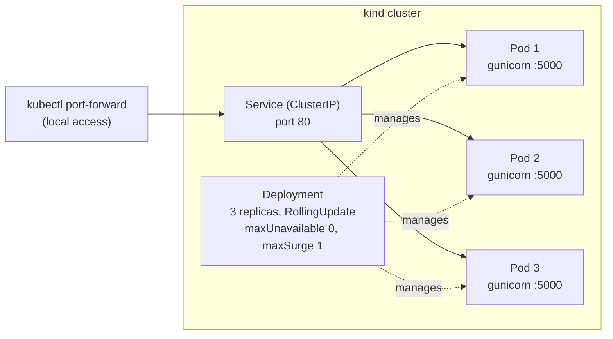

# Kubernetes Application Deployment & Self-Healing

[](https://github.com/Priyanshu-1706/k8s-self-healing-app/actions/workflows/ci.yml)

This is a small Flask app I containerized and deployed on Kubernetes (kind) to
get hands-on practice with the things that actually matter in production:
replicas, health probes, resource limits, rolling updates and rollback.

I ran every self-healing test myself on a local cluster and kept the terminal
output in [docs/test-results.md](docs/test-results.md). If you want to see it
happening live, [docs/demo-script.md](docs/demo-script.md) has the exact
sequence of commands I used.

## What the project does

- Runs the app with 3 replicas behind a ClusterIP Service
- Liveness and readiness probes on `/health`
- CPU/memory requests and limits on every pod
- Demonstrates pod replacement, container restarts and probe-driven recovery
- Scaling from 3 to 5 replicas and back
- Zero-downtime rolling updates, plus rollback after a deliberately bad deploy

## Architecture



Each pod runs the same image: python:3.12-slim, gunicorn with 2 workers, the
Flask app, all as a non-root user. The Deployment keeps 3 replicas alive and
the Service only sends traffic to pods that pass their readiness probe.

## Endpoints

| Endpoint | What it does |
|---|---|
| `GET /` | Dashboard page. Polls `/stats` every 2 seconds, so uptime and the request counter tick live. Turns red when the app is unhealthy |
| `GET /health` | Returns 200 with `{"status":"healthy"}` when healthy, 503 otherwise. This is what the probes hit |
| `GET /stats` | JSON with status, version, pod hostname, uptime, requests served and PID |
| `GET /toggle-health` | Demo helper. Flips `/health` between 200 and 503 using a marker file in /tmp. A container restart clears it, which is what makes the liveness demo work |

The pod hostname on the dashboard changes when you reload, since the Service
balances across replicas.

## Prerequisites

- Docker
- kind (`brew install kind`)
- kubectl
- Python 3.12+ if you want to run it without Docker

## Quickstart

```bash
docker build -t k8s-self-healing-app:1.2.0 .

kind create cluster --name k8s-self-healing

# kind runs its own container runtime, so it can't see images on your machine
kind load docker-image k8s-self-healing-app:1.2.0 --name k8s-self-healing

kubectl apply -f k8s/
kubectl rollout status deployment/k8s-self-healing-app

kubectl port-forward svc/k8s-self-healing-app 8080:80
curl http://localhost:8080/health
```

## The self-healing tests

Details and output in [docs/test-results.md](docs/test-results.md).

| Test | Command | What happened |
|---|---|---|
| Pod replacement | `kubectl delete pod <pod>` | New pod came up in seconds, traffic never hit the dead one |
| Container restart | `kubectl exec <pod> -- sh -c "kill 1"` | Same pod, RESTARTS went 0 to 1, Ready again in ~15s |
| Probe recovery | hit `/toggle-health` on one pod | Readiness pulled it from the Service at ~30s, liveness killed and restarted the container at ~50s, no manual fix needed |
| Scaling | `kubectl scale deployment/k8s-self-healing-app --replicas=5` | 5/5 Ready, then scaled back to 3 |
| Rolling update | `kubectl set image deployment/k8s-self-healing-app flask=...:<new>` | Probe pod got 35/35 successful responses during the rollout |
| Rollback | `kubectl rollout undo deployment/k8s-self-healing-app` | Deployed a tag that doesn't exist. New pod stuck in ImagePullBackOff, old pods kept serving (25/25 OK), one command to roll back |

## Troubleshooting

Things I ran into or expect people to hit:

| Symptom | Cause | Fix |
|---|---|---|
| Pod stuck in `ErrImagePull` | Image not loaded into kind | `kind load docker-image  --name k8s-self-healing` |
| Pod stuck `Pending` | Node can't fit the resource requests | `kubectl describe pod <pod>`, check Events, lower requests |
| `CrashLoopBackOff` | App crashes on startup | `kubectl logs <pod>` and `kubectl logs <pod> --previous` |
| Pod `0/1 Running` for a while | Readiness probe failing | `kubectl describe pod <pod>`, probe errors are at the bottom |
| port-forward dies randomly | It tunnels to one pod, so it breaks when that pod is replaced | Just run it again |
| Same hostname on every reload | That's port-forward going to a single pod | Use the in-cluster loop in demo-script.md to see the balancing |

## Cleanup

```bash
kubectl delete -f k8s/
kind delete cluster --name k8s-self-healing
docker rmi k8s-self-healing-app:1.0.0 k8s-self-healing-app:1.1.0 k8s-self-healing-app:1.2.0
```

## Repository layout

```
app.py                     Flask app: /, /health, /stats, /toggle-health
requirements.txt           Flask 3.0.3, Werkzeug 3.0.3, gunicorn 22.0.0 (pinned)
Dockerfile                 python:3.12-slim, non-root user, gunicorn
.dockerignore
.github/workflows/ci.yml   build + smoke tests + manifest validation
k8s/deployment.yaml        3 replicas, probes, resources, RollingUpdate
k8s/service.yaml           ClusterIP, port 80 to 5000
docs/test-results.md       output from the tests I ran
docs/demo-script.md        command sequence for a live demo
```

## Notes on security

The container runs as a non-root user (uid 1000). There are no secrets or
credentials anywhere in this repo. Dependencies are pinned so CI builds the
same image I tested locally.
